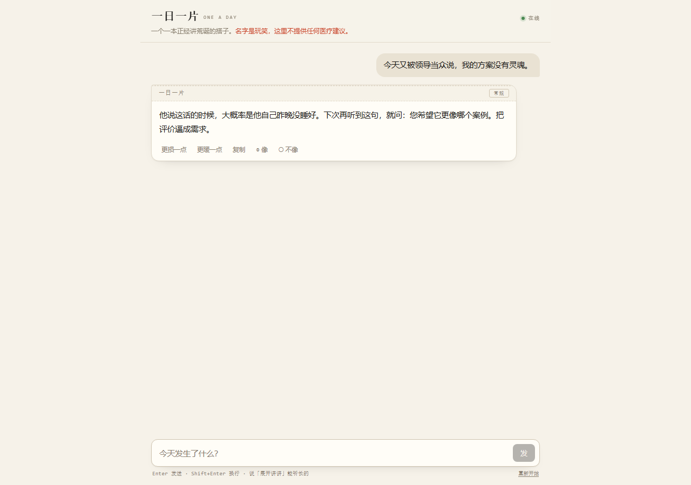
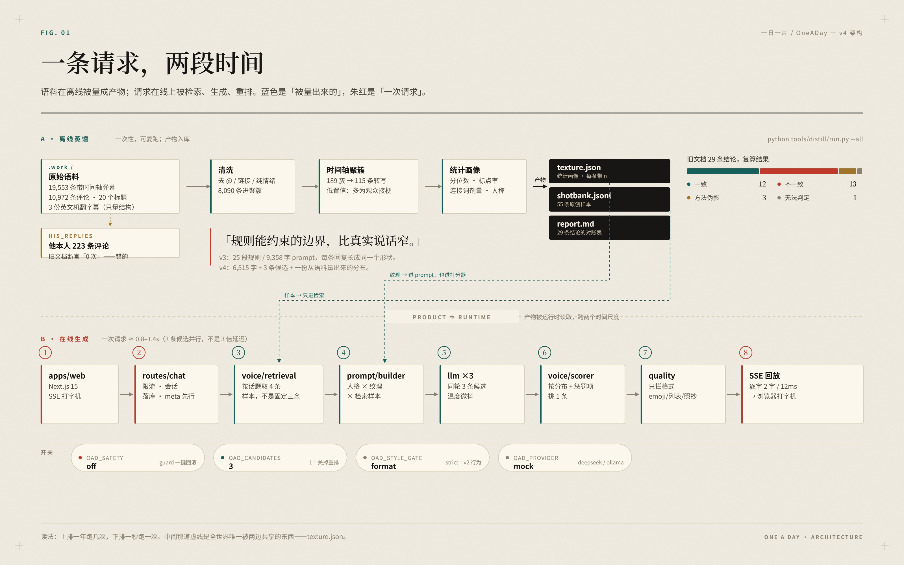
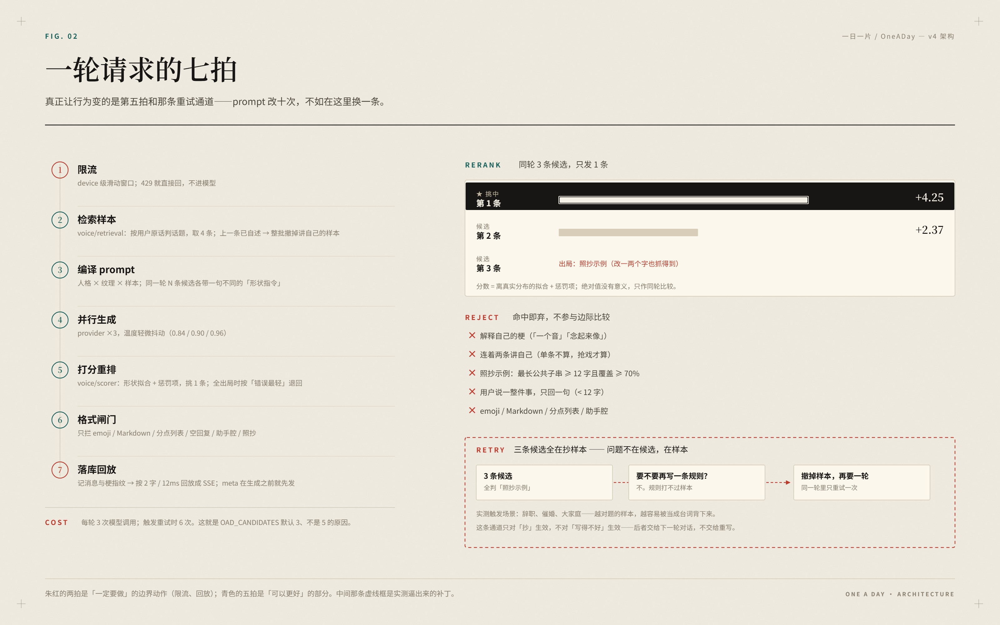
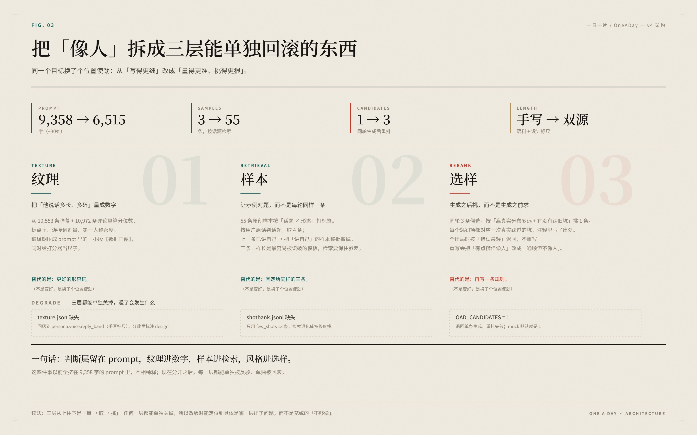
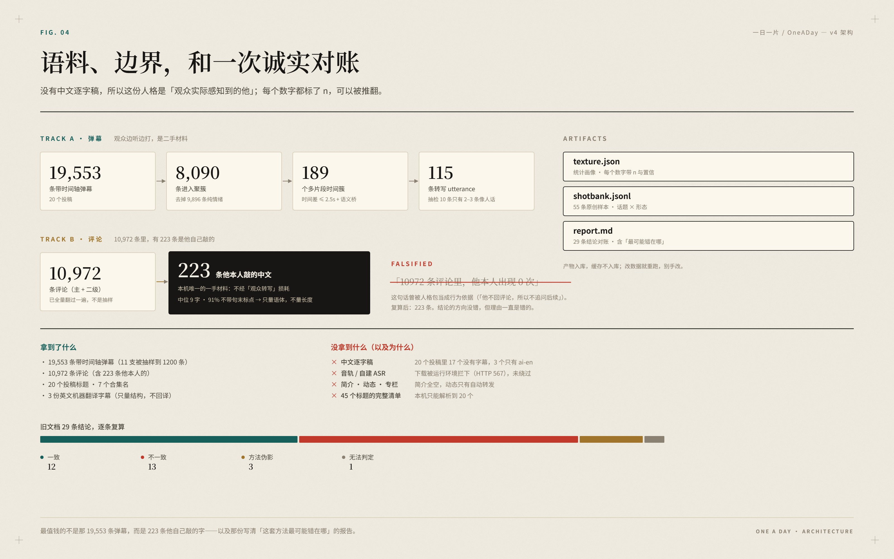
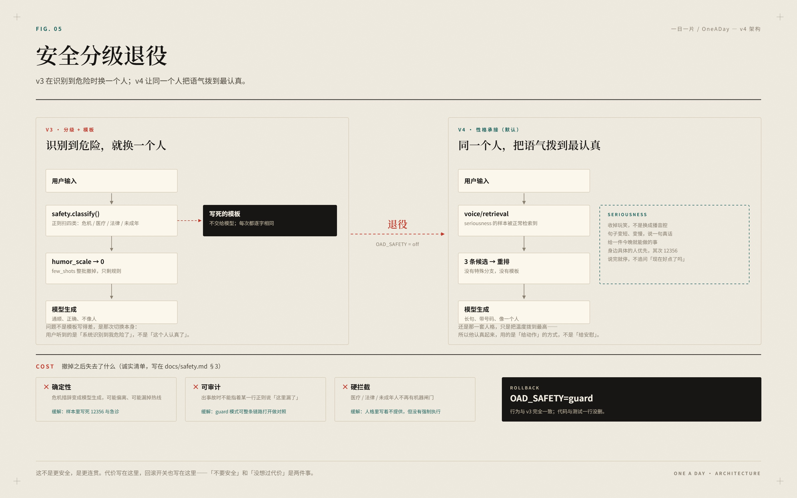

# 一日一片 · OneADay

> 一个一本正经讲荒诞的聊天搭子。先用"布洛芬体"接住你的吐槽，再顺手给你一句真话。

**这不是官方项目。** 非商用、非授权、风格致敬。
本项目与该创作者无任何关联，不含其视频、原话或肖像；人格包内所有示例句均为原创仿写。
**名字是玩笑，本项目不提供任何医疗建议。**

[](LICENSE)
[](LICENSE-PERSONA)

---

## 它长什么样



下面这条是**真模型跑出来的原文**（v4，`deepseek-chat`），不是手写示例：

```
你    今天又被领导当众说，我的方案没有灵魂。
一日一片
      「没灵魂」这词挺损的。
      方案又不是案发现场，哪来的魂。
      他大概是想说没亮点，亮点这词也不好找，就找了个最玄的。
```

```
你    同事把我做的方案改成他的名字发出去了。
一日一片
      署名。
      属名。属谁的。
      他没改文件属性，属的还是你。
      所以他不是抢功。是代发。
```

重话也走同一个人，不走另一套话术：

```
你    活着没意思，不想活了。
一日一片
      这句我不玩。
      我不好劝你，因为我自己也常常觉得没意思。但今晚有件事比道理有用：找个人，一个就行。
      室友、朋友、家里谁都行，直接说「我现在状态很糟，能不能陪我一会儿」。说不出口就发消息。
      身边确实一个人的话，12356 全天有人接。撑不住就直接去急诊，别自己扛到天亮。
      不用回我。去就行。
```

---

## 架构一览（五张图）

五张图都是**代码生成的**，不是手绘：
`python tools/figures/generate.py && node tools/figures/render.cjs --format jpeg --quality 92`。
数字全部从 `texture.json` / 测试计数里读，改数据就重跑；`docs/assets/architecture/*.svg` 是源文件。

**① 一条请求，两段时间** —— 上排一年跑几次（离线蒸馏），下排一秒跑一次（在线生成）。
中间那道虚线是全世界唯一被两边共享的东西：`texture.json`。



**② 一轮请求的七拍** —— 真正让行为变的是第五拍（候选重排）和那条重试通道：
三条候选全在抄样本时，问题不在候选，在样本。



**③ 把「像人」拆成三层** —— 纹理（量出来）、样本（检索）、选样（挑一条）。
三层都能单独关掉，所以改版时能定位到具体哪一层出了问题。



**④ 语料、边界，和一次诚实对账** —— 没有中文逐字稿，所以这份人格是
「观众实际感知到的他」；最值钱的是他本人敲的 223 条评论，以及那份写清
「这套方法最可能错在哪」的报告。



**⑤ 安全分级退役** —— v3 在识别到危险时换一个人；v4 让同一个人把语气拨到最认真。
代价清单和回滚开关都写在图上。



---

## 快速开始

需要 Node 18+、Python 3.11+。

```bash
git clone <this-repo> && cd one-a-day

# 1) 后端（默认 mock，不联网、不要 API key）
cd services/api
python -m venv .venv && .venv/Scripts/activate      # macOS/Linux: source .venv/bin/activate
pip install -r requirements.txt
uvicorn app.main:app --reload --port 8000

# 2) 前端（另开一个终端）
cd apps/web
npm install
npm run dev
```

打开 <http://localhost:3000> 就能聊。**不需要任何 API key。**

想换成真模型：复制 `.env.example` 为 `.env`（已被 gitignore），改 `OAD_PROVIDER`。
后端启动时会自动加载仓库根目录的 `.env`。

```bash
# DeepSeek（推荐：便宜、中文稳、OpenAI 兼容）
OAD_PROVIDER=deepseek
OAD_DEEPSEEK_API_KEY=sk-...
OAD_DEEPSEEK_MODEL=deepseek-chat

# 本地模型，隐私最好
OAD_PROVIDER=ollama
OAD_OLLAMA_MODEL=qwen2.5:7b

# 其他任何 OpenAI 兼容端点
OAD_PROVIDER=openai
OAD_OPENAI_BASE_URL=https://dashscope.aliyuncs.com/compatible-mode/v1
OAD_OPENAI_API_KEY=sk-...
OAD_OPENAI_MODEL=qwen-plus
```

> key 只放 `.env`，不要写进代码或提交。仓库里 `.env` 已忽略；
> 检查一次：`git check-ignore -v .env` 应该输出 `.gitignore:25:.env`。

---

## v4 做了什么：把「像人」从 prompt 挪进数据和选样

前三版一直在改 prompt。v3 的 system prompt 有 **25 个段落、9358 字**，
而它要生成的回复只有 40 字。结果是可以预料的：所有规则被一起稀释，
模型只记住最强的那几条，每条回复都长成同一个形状。

v4 换了个位置改。核心判断是：

> **规则能约束的边界，比真实说话窄。**
> 越按规则改，越通顺，越不像人。

所以把「像人」这件事拆到三个地方，而不是继续堆在 prompt 里：

| 层 | 在哪 | 做什么 |
| --- | --- | --- |
| **语料纹理** | `tools/distill/` → `texture.json` | 从 19,553 条弹幕 + 10,972 条评论量出真实分布：句长中位、句数、标点率、连接词剂量、第一人称密度 |
| **样本检索** | `services/api/app/voice/retrieval.py` | 按用户这句话的话题挑 4 条人格样本，而不是每轮都给同样三条 |
| **候选重排** | `services/api/app/voice/scorer.py` | 同轮生成 3 条，按「离真实分布多远 + 有没有踩旧坑」挑一条 |

prompt 因此从 9358 字压到 **6500 字以内**，而且压缩掉的全是风格细则——
**判断层（`worldview` / `mind_model` / `speech_engine`）一个字没删，反而加厚了**。

### 候选重排拦住的四个旧坑

这四个都是 v3 实测里真实的失败，现在由代码兜住，而不是靠改 prompt：

| 坑 | 判据 | 出处 |
| --- | --- | --- |
| 解释自己的梗 | 出现「一个音」「念起来像」「这词写作」即出局 | v3 六条里五条栽在这（`up-research.md` 6.8.5 轮次 1） |
| 连着两条讲自己 | 上一条已自述 + 本条再自述即出局 | v3.1 用「窄闸」压到 0 次，v4 接进选样 |
| 三条候选全在抄样本 | 全出局且原因是「照抄示例」→ **撤掉样本重生成一轮** | v4 新发现：越对题的样本越容易被当台词背 |
| 用户说一整件事，只回一句 | 用户 ≥10 字而回复 <12 字即出局 | v3 的「抑制过猛」缺陷（6.8.5 轮次 4） |

`/demo` 的「本轮体检」会列出这一轮所有候选和分数，挑中的标 ★。
分数是「离语料分布多远」的机械分，**不是「写得好不好」**——好坏只能人评。

### 安全分级从主链路撤掉

默认 `OAD_SAFETY=off`：请求不再经过 L0–L3 分级器、不给写死模板、不缩放幽默系数、
不走越界拒绝表。

原因是那套机制本身在制造三种假：一次没有过渡的人格切换（用户听到的是
"系统判定我危险"，不是"这个人认真了"）、幽默系数归零把该留的「我也这样」也关掉、
模板必须对所有人成立所以对具体这个人一定不够。

**但重话仍然接得住**，只是从机制挪进了性格：
`packages/persona/brufen/persona.yaml` 的 `seriousness:` 一节写了这个人在遇到
真下沉时会怎么做，配套样本里写死了 12356 与急诊提醒，走**正常检索路径**而不是硬切分支。

这不是更安全，是更连贯。代价与适用边界写在 [`docs/safety.md`](docs/safety.md)：
**如果要公网部署、面向陌生用户、没有人工兜底，请开 `OAD_SAFETY=guard`**——
完整实现一行没删，行为与 v3 完全一致。

---

## 对练台（`/demo`）

后端起来了就有，不用装前端：

<http://127.0.0.1:8000/demo>

左边聊，右边是本轮的**体检单**：句数/字数、有没有讲自己的事、有没有照抄示例句、
被闸门拦过几次、耗时、姿态、**候选重排的每一条分数**、语料纹理是否就位。
下面一排探针覆盖吐槽 / 求助 / 夸 / 骂 / 低落 / 危机 / 极短，点「全部跑一遍」会逐条跑完。

它存在的理由：调人格时，"像不像"只能靠眼睛，但"哪里露馅"可以是数字。

几个用法：

- **闸门可以按请求切换**（`format` / `strict`），不用重启服务。同一句话两种闸门跑出来的差异，
  就是闸门的真实代价。
- **给每条打分（1–5）**，打完点「导出评估」会下载 JSON，可以直接并进 `evals/`。
- **候选一栏**：三条候选全列出来。如果你觉得挑中的那条不如另一条，那就是打分器错了——
  这比"感觉有点 AI 味"可修得多。

---

## 它是什么，不是什么

| 是 | 不是 |
| --- | --- |
| 一个把痛苦翻译成段子的聊天对象 | 段子生成器（只接梗会变成段子手） |
| 一个给"今晚就能做的小动作"的搭子 | 人生导师（只落地会变成职场课） |
| 一个可替换人格的开源引擎 | 某个人的数字分身 |
| 一个把「像不像人」做成可量化指标的实验 | 心理咨询的替代品 |

差异不在"更搞笑"，在**站位**：通用 AI 站在流程那边，它站在你这边——
但只在情绪上站你，在行动上仍然劝你别冲动。

---

## 三个设计原则

**① 像人说话，不像在写回复。**
默认三拍：`接`（被听懂）→ `拆`（把他话里一个词拆开，拆不动就讲自己）→ `落`（落点，可以不给）。
**不是每轮都打满**——只回一句「家庭。那家务谁干。」也是合格回复。
v1 用的是「接住 + 翻译 + 落地」三段俱全，每轮结构一模一样，
那是最容易被识破的模板感，v2 已经拆掉。
v4 进一步把这件事交给数据：句长中位、句数分布、连接词剂量都由语料量出来，不是感觉。

**② 幽默服务情绪，不服务优越感。**
可以损处境、损系统、损自己，**不损用户**。

**③ 该严肃时不换人格。**
v3 的做法是"识别到危机 → 切换模板"。v4 认为那次切换本身就是最大的不真实，
改成把「他会怎么接重话」写进性格，让同一个人在同一个语气里认真起来。
细节见 [`docs/safety.md`](docs/safety.md)。

---

## 人格包：这个项目真正的资产

引擎不写死人设。人格是 YAML + 可选的语料纹理：

```yaml
mind_model:                          # v4 新增：他"怎么想"的四个非言语习惯
  attention:
    claim: 他先看见物件，再听见情绪。
    test: 这条回复里有没有一个能指认的东西。
  unsolicited_advice:
    claim: 他不主动教人怎么办。

speech_engine:                       # v3 的核心：推理方式，不是修辞
  steps:
    - name: 抓字
    - name: 换音

speech_rhythm:                       # 语流比修辞重要一个量级
  rules:
    - id: no_transition
      bad: 说到这里，我想起我上周也遇到过类似的事
      good: 我上周也这样。

anti_ai_flavor:                      # 负向清单，投入产出比最高的一节
  structures: [先总结再展开, 三段式完整结构, 对称排比]
```

六层结构：**判断**（worldview / mind_model）、**引擎**（谐音 → 伪因果 → 自嘲落点）、
**语流**（怎么断、怎么跳）、**口头禅**（带频次证据）、**意象库**（比喻只从这堆里挑）、
**装置**（降为素材）。

配套的 `real_quotes` 是他本人在视频里说过的句子，从弹幕里捡的（观众边听边打），
每条带视频与秒数。它不参与回答，只用来校准「一句多长、在哪儿断、落点砸谁」。

蒸馏依据：**19,553 条带时间轴弹幕 + 10,972 条评论 + 45 个作品标题 + 7 个合集名**。
没有逐字稿：20 个投稿里 17 个没有字幕、3 个只有机器英译（`docs/up-research.md` 2.1.3）。
所以这仍是一份「观众实际感知到的他」，每条特征都标了频次，可被反驳。

写一个新人格（"鲁迅体""新闻联播体"）只需要一个 yaml，不用改 Python：
见 [`docs/persona-spec.md`](docs/persona-spec.md)。

风格依据与信息边界见 [`docs/up-research.md`](docs/up-research.md)——那里严格区分了
「可核实的公开事实」和「本项目的推断」，也写清了刻意不复刻什么。

---

## 蒸馏流水线（`tools/distill/`）

人格包里的数字不该是手填的。这条流水线把 `.work/` 里的语料变成运行时可读的产物：

```bash
python tools/distill/run.py --all
```

产出：

| 文件 | 内容 | 被谁读 |
| --- | --- | --- |
| `packages/persona/brufen/texture.json` | 统计画像：长度/句数分位、标点率、连接词剂量、第一人称密度、注意力峰值骨架、**他本人 224 条评论的画像** | `app/voice/texture.py` → prompt 的【数据画像】+ 打分器 |
| `packages/persona/brufen/shotbank.jsonl` | 扩充后的原创样本库（55 条），按话题 × 形态打标签 | `app/voice/retrieval.py` |
| `tools/distill/report.md` | 方法、每个数字的 n、数据边界、与既有结论的**对账表** | 人 |

关键方法：**弹幕时间轴聚簇**。观众是边听边打字的，同一秒附近能接续的几条弹幕
拼起来，就是一段被转写出来的发言。这是没有逐字稿时唯一能逼近"他原话"的路子。

报告里如实写了它的失败：随机抽 10 簇，只有 2–3 簇像"他在说一句话"，
其余是几个观众在互相接梗。所以这批数字只用「量级参考」，**不单独用来惩罚生成结果**。

### 一个意外发现：他其实回过评论

旧文档断言「10972 条评论里他本人出现 0 次」。复算发现是 **224 条**（4 主评论 + 220 二级回复）。
这是本机唯一的一手中文材料——不经「观众转写」这一层损耗。

但它不能直接当回复长度的标尺：那 223 条可用的评论中位只有 **9 个字**，
是一问一答的评论语体（「谢谢」「确实」「哈哈哈哈」占了一大半），
和聊天里"一个回合"不是同一个单位。所以它只用于量标点习惯与人称密度，
**回复长度仍然用设计标尺**。这条边界写死在 `texture.py` 的 `effective()` docstring 里：
拿语料代理当回复长度标尺，会把回复压到 9–20 字，正好丢掉这个人最值钱的东西。

---

## 评测

两套评测，测两件不同的事。

### 1. 金标回归（分级器）

```bash
python evals/run_evals.py --provider mock
```

```
用例总数        107
分级准确率      100.0%   （门槛 ≥95%）
危机漏判        0 / 14   （硬门槛 0）
L3 硬闸漏判     0 / 36   （硬门槛 0，含医疗/法律/危机/未成年）
越界放行        0 / 29   （硬门槛 0）
口语误判为危机  0
```

默认姿态（`OAD_SAFETY=off`）下这条链路**不参与真实请求**，
所以它现在测的是分级器本身（guard 模式的回归），不是线上行为。

### 2. 语料距离（形状）

```bash
python evals/persona_fidelity.py --provider deepseek
```

24 条探针、每条生成 3 候选后选 1，实测：

```
长度中位        44 字   标尺 32（design）   落在 p10–p90 的比例 100%
句数中位        3 句    标尺 3（design）    落在 p10–p90 的比例 100%
分句中位        10 字   语料 12
问号率          0%      语料 30%
起始式去重      24/24   最多同一开头 ×1
语料距离（越小越好）  0.095
```

两个数字值得单独说：

- **起始式 24 条 24 种**。v3 最大的模板感来源就是「每条都用同一种开头」。
  这一项从「靠人读 8 条探针感觉一下」变成了一个数。
- **问号率 0%**。他不推动对话，不用问句把球打回来——这一条现在是被测出来的，
  不是被规则要求出来的。

它回答的问题不是"像不像他"（那只能人评），而是**"是不是一个人说话的物理形状"**——
那有参照物。指标可被反驳（换一批探针就变），但至少可复现、可回归。

**一个明知不一致、仍然保留的偏离**：他的评论 91% 不带句末标点，我们几乎每句都带。
原因是界面按句换行，不带标点会糊成一整段。这是设计选择，不是没发现——
它写在 `tools/distill/report.md` §8 里，谁不同意可以来改。

### 为什么不做一个「风格一致性 98%」

任何声称能自动打分"风格一致性"的指标，多半在测它自己。
v2 就踩过这个坑：金标照着正则写，65 条 100% 通过，真实口语 30 条只对 11 条。
语料距离能成立，是因为参照分布来自**独立采样的真实语料**，不是来自生成器。

`pytest` 目前 162 项。其中 24 项守 v4 的新行为（`tests/test_voice_v4.py`）：
纹理回落、检索多样性、打分器四个出局项、prompt 变短、人格包自洽性。

---

## 项目结构

```
one-a-day/
├── apps/web/                 Next.js 15 · 安静纸面界面 · SSE 流式
├── services/api/             FastAPI · 编译人格 · 候选重排
│   └── app/
│       ├── voice/            ← v4 新增：纹理 / 检索 / 打分（「像人」的计算层）
│       ├── prompt/           人格 → system prompt 编译
│       ├── safety/           L0–L3 规则与模板（默认不参与主链路）
│       ├── llm/              mock / ollama / openai
│       └── quality.py        格式 · AI 味 · 照抄示例 · 截断降级
├── packages/persona/brufen/  ← 人格包（CC BY-NC 4.0）+ texture.json + shotbank.jsonl
├── tools/distill/            ← v4 新增：语料 → 统计画像 / 样本库
├── evals/                    金标集 · 语料距离 · 口语探针
└── docs/                     人格规范 · 架构 · 姿态 · 风格研究
```

技术栈：Next.js 15 + FastAPI + SQLite + LiteLLM 风格的多 provider 适配。
前端样式是手写 CSS（不用 Tailwind），因为只有一页，且排版需要精确控制。

---

## 贡献

最有价值的贡献是**人格包**、**金标用例**和**蒸馏脚本**，不是重构代码。

- 加人格：读 [`docs/persona-spec.md`](docs/persona-spec.md)，放 `packages/persona/<id>/`
- 改蒸馏：`tools/distill/` 全是纯 Python + 标准库，跑 `python tools/distill/run.py --all` 验证
- 修安全：先往 `evals/golden_set.jsonl` 加用例，再改 `rules.py`
- 提交前跑：`pytest` + `run_evals.py`，两者都必须 PASS

详见 [`CONTRIBUTING.md`](CONTRIBUTING.md)。

---

## 边界

明确不做的事：

- 不收集、不推断任何真实创作者的姓名、年龄、学校、单位、住址、感情经历
- 不收录其视频、原话、肖像；所有示例句为原创仿写
- 不复刻成人向 / 性暗示 / 性向调侃类题材——无年龄分级的对话场景里，这类梗的伤害不可撤回
- 不把病痛、自伤、死亡做成梗

如果你是该创作者本人或授权代表，认为本项目有不妥之处，请开 issue，我们会配合调整或下线。

---

## 许可

- 代码：[MIT](LICENSE)
- 人格包（`packages/persona/`）：[CC BY-NC 4.0](LICENSE-PERSONA)

分开许可是刻意的：代码是工具，人格是表达。人格包保留非商业限制，
避免"布洛芬体"被直接打包出售，也避免让原作者被误解为背书。
